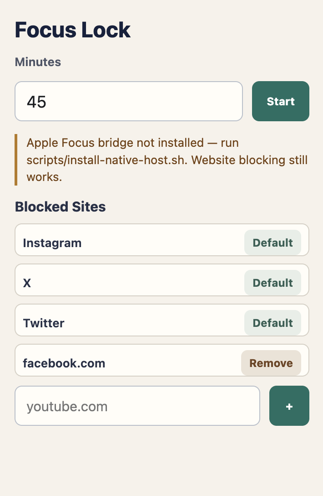
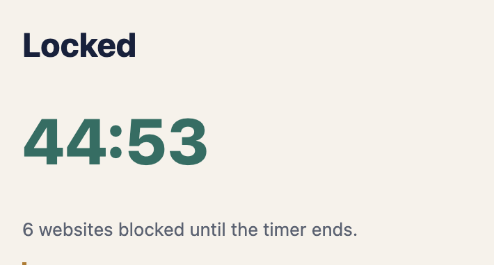

<h1 align="center">Focus Lock</h1>

<p align="center"><strong>Start a timer and distracting sites stay blocked until it ends. No stop button.</strong><br/>
It also turns on Apple Focus, so your Mac and iPhone go quiet too.</p>

<p align="center">
  
  
  
  
  
</p>

<p align="center">
  
  &nbsp;&nbsp;
  
</p>

## Why

Most site blockers have an off switch one click away, so they don't hold up when you're tempted. And blocking sites in the browser does nothing about your phone buzzing. Focus Lock fixes both: once a lock starts, it can't be stopped early from the extension, and it reaches past the browser to silence notifications on all your Apple devices.

## What it does

- **Blocks sites until the timer ends.** Instagram and X/Twitter are always on the list, and you can add more before you start a lock.
- **No way out early.** There's no stop button while locked, and the lock survives Chrome restarts because its state and end time are saved and re-checked on every launch.
- **Silences your devices.** A small macOS helper runs your *Focus Lock Start* / *Stop* Shortcuts, which turn Apple Focus on and off. With Share Across Devices enabled, your iPhone follows along.
- **Is honest about its limits.** Chrome always lets you remove your own extensions, and no regular extension can prevent that. Focus Lock just makes quitting take deliberate effort.

## How it works

```
Popup ──start lock──▶ background service worker
                      ├─ chrome.storage    saves lock state + end time
                      ├─ chrome.alarms     wakes up when the lock ends
                      ├─ declarativeNetRequest  dynamic block rules
                      └─ native messaging ──▶ focus_lock_host.py (macOS)
                                              └─ `shortcuts run "Focus Lock Start"`
```

The Python native host does only two things: run the start Shortcut or run the stop Shortcut. It runs nothing else, so the browser can't use it to execute other commands. If the helper fails, sites are still blocked and the popup says that Apple Focus didn't turn on. The lock's end time is saved as an exact clock time rather than a countdown, so restarting Chrome never resets the timer.

## Setup

**1. Create two macOS Shortcuts** in the Shortcuts app:

| Name | Action |
| --- | --- |
| `Focus Lock Start` | Set Focus → your Focus mode (e.g. *Deep Focus*) → **On** |
| `Focus Lock Stop` | Set Focus → the same mode → **Off** |

Turn on **Share Across Devices** in Focus settings so your iPhone follows your Mac.

**2. Load the extension.** Open `chrome://extensions`, turn on **Developer mode**, click **Load unpacked**, select the `extension/` folder, and copy the extension ID.

**3. Install the native helper:**

```bash
./scripts/install-native-host.sh <extension-id>
```

## Testing

```bash
npm install && npx playwright install chromium
./scripts/validate.sh          # runs every repeatable check below
npm run test:background        # service-worker logic
npm run test:e2e               # full browser test
./scripts/test-native-host.py start   # runs your real Shortcuts
./scripts/test-native-host.py stop
```

The end-to-end test loads the extension in Chrome for Testing, adds a custom site, starts a one-minute lock, and confirms that Instagram and the custom site are blocked while a neutral page still loads. It uses Chrome for Testing because current Google Chrome no longer accepts unpacked extensions from the command line.

There's also an in-browser self-test: open `chrome-extension://<extension-id>/self-test.html` and click **Run**. It validates the blocking rules through Chrome's own API and runs a real one-minute lock.
